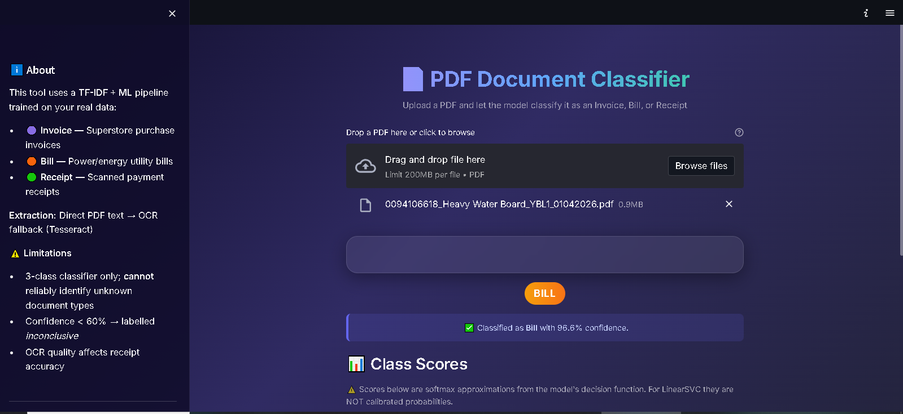

# PDF Document Classification Using OCR and Machine Learning

An audited, reproducible, end-to-end PDF document classification system that categorizes documents into **Bill**, **Invoice**, and **Receipt** using PyMuPDF text extraction, embedded Tesseract OCR fallback, and a scikit-learn TF-IDF + Logistic Regression / Linear SVM pipeline.

---


## 📁 Project Structure

```
pdf_analyzer(miniPrj1)/
├── bill/                        # SOURCE: 102 utility/energy bills (original files, unmodified)
├── invoices/                    # SOURCE: 1,035 purchase invoices + ReadMe.txt (original files, unmodified)
├── receipts/                    # SOURCE: 190 scanned receipts (original files, unmodified)
├── tessdata/                    # Embedded OCR language data (eng.traineddata)
├── conftest.py                  # Pytest environment configuration
├── requirements.txt             # Verified Python dependencies
├── README.md                    # Audited project documentation
│
└── pdf_classifier/              # Application package
    ├── __init__.py
    ├── config.py                # Centralized paths, classes, and hyperparameters
    ├── logger.py                # Console and timestamped file logging
    ├── preprocessor.py          # Normalization, tokenization, whitespace cleanup
    ├── extractor.py             # PyMuPDF direct extraction + embedded OCR fallback
    ├── build_corpus.py          # PDF discovery, deduplication, cached extraction, corpus export
    ├── eda.py                   # Exploratory data analysis, stats, charts, JSON summaries
    ├── train.py                 # Grouped stratified splitting, GridSearchCV tuning, held-out evaluation
    ├── predict.py               # Single PDF inference with confidence and inconclusive flagging
    ├── app.py                   # Streamlit web UI with glassmorphic cards and analytics
    ├── tests/
    │   ├── __init__.py
    │   ├── test_extractor.py    # 5 unit tests for extraction, hashing, corrupt files
    │   ├── test_preprocessor.py # 11 unit tests for text normalization and regex
    │   └── test_pipeline.py     # 8 integration tests for model loading, classes, inference
    └── outputs/
        ├── corpus.csv           # 1,327 extracted and labeled documents
        ├── corpus_backup.csv    # Preserved prior corpus backup
        ├── models/
        │   ├── pipeline.joblib  # Serialized production pipeline
        │   ├── lr_pipeline.joblib
        │   └── svm_pipeline.joblib
        ├── reports/
        │   ├── eda_summary.json # Machine-readable dataset audit summary
        │   ├── eda_report.txt   # Human-readable EDA text report
        │   ├── class_distribution.png
        │   ├── extraction_methods.png
        │   ├── text_length_distribution.png
        │   ├── confusion_matrix.png
        │   ├── evaluation.json  # Complete classification metrics & confusion matrix
        │   └── evaluation.txt   # Human-readable model evaluation report
        └── logs/                # Execution logs
```

---

## 📊 Dataset Inventory & Audit Findings

The workspace contains **1,327** original PDF files across three directories:

| Category | Source Folder | Document Count | Format & Properties | Extraction Method | Usable for Training |
| :--- | :--- | :--- | :--- | :--- | :--- |
| **Bill** | `bill/` | 102 | 2–3 pages; utility & power transmission bills | Direct (101) + OCR (1) | **102** (100.0%) |
| **Invoice** | `invoices/` | 1,035 | 1 page (1,007) / 3 pages (28); retail & utility bills | Direct (1,035) | **1,035** (100.0%) |
| **Receipt** | `receipts/` | 190 | 1 page; scanned store & restaurant receipts | OCR (187) + Empty (3) | **187** (98.4%) |
| **Total** | — | **1,327** | — | **1,136 Direct + 188 OCR** | **1,324** (99.8%) |

### Data Quality & Provenance Notes
1. **Invoice Data Provenance**: Invoices were created by Ajigbayi, Oluwafemi Tosin using the Tableau Superstore dataset (see `invoices/ReadMe.txt`).
2. **Misplaced Power Bills in Invoices**: Exactly **28 files** in `invoices/` (starting with `0094...`) are 3-page utility bills from power companies (BSES, Adani, etc.) with the exact same template as files in `bill/`. Per project requirements, their folder label is preserved as ground truth, but they are tracked and flagged in error analysis.
3. **Excluded Empty Scans**: Exactly **3 receipt files** (`receipt_034.pdf`, `receipt_117.pdf`, `receipt_136.pdf`) are faint or blank scanned pages yielding under 30 characters. They are safely assigned `status=empty` and excluded from model training.
4. **Data Preservation**: All original PDF files in `bill/`, `invoices/`, and `receipts/` remain untouched and preserved.

---

## 🔬 Machine Learning Architecture & Verification

### Data Splitting (Leakage Prevention)
- **Grouping**: Documents are grouped by `clean_text` hash to guarantee identical and template-duplicate documents never cross splits.
- **Stratified Group Split**:
  - **Train**: 930 documents (727 Invoice, 131 Receipt, 72 Bill)
  - **Validation**: 196 documents (153 Invoice, 28 Receipt, 15 Bill)
  - **Held-Out Test**: 198 documents (155 Invoice, 28 Receipt, 15 Bill)
- **Zero Leakage**: Verified zero hash or group overlap between train, validation, and test splits.

### Hyperparameter Tuning & Model Selection
- **Cross-Validation**: 5-fold Stratified K-Fold strictly on the training set.
- **Tuned Hyperparameters**: Explored `C` (0.5, 1.0, 5.0), `max_features` (10,000, 20,000), `ngram_range` ((1, 1), (1, 2)).
- **Validation Comparison**:
  - Baseline Logistic Regression: Accuracy = `0.9745`, Macro F1 = `0.9468`
  - Linear SVM: Accuracy = `0.9745`, Macro F1 = `0.9468`
  - Tuned Logistic Regression: Accuracy = `0.9745`, Macro F1 = `0.9468`
- **Final Model Fit**: Selected winning model architecture refit on all development data (Train + Validation = 1,126 documents).

### Held-Out Test Evaluation (198 Documents)

Evaluated strictly once on the held-out test split:

```
              precision    recall  f1-score   support

        Bill     0.7895    1.0000    0.8824        15
     Invoice     1.0000    0.9742    0.9869       155
     Receipt     1.0000    1.0000    1.0000        28

    accuracy                         0.9798       198
   macro avg     0.9298    0.9914    0.9564       198
weighted avg     0.9841    0.9798    0.9809       198
```

- **Overall Test Accuracy**: **97.98%** (194 / 198 correct)
- **Test Macro F1**: **0.9564**
- **Test Weighted F1**: **0.9809**
- **Error Analysis**: Exactly 4 documents were misclassified in the test set. All 4 misclassifications were power utility bill files (`0094...`) located inside the `invoices/` directory that were predicted as `Bill`. Zero receipts or standard Superstore invoices were misclassified.

---

## 🛠️ Step-by-Step Workflow & Commands

### 1. Environment Setup
Install verified dependencies:
```bash
pip install -r requirements.txt
```

### 2. Run Automated Test Suite
Run all 24 unit and integration tests:
```bash
python -m pytest pdf_classifier/tests/ -v
```

### 3. Build & Refresh Dataset Corpus
Extracts all digital PDFs and runs embedded OCR fallback on scanned files:
```bash
python -m pdf_classifier.build_corpus
```

### 4. Run Exploratory Data Analysis & Quality Audit
Generates data quality metrics, summary statistics, and plots:
```bash
python -m pdf_classifier.eda
```

### 5. Train & Evaluate Pipeline
Runs grouped stratified splitting, hyperparameter tuning, model selection, held-out evaluation, and saves the model pipeline:
```bash
python -m pdf_classifier.train
```

### 6. Single Document Prediction (CLI)
Predict any PDF from the command line:
```bash
python -m pdf_classifier.predict "bill/0094106605_BSES Rajdhani Power Limited_YBL1_01042026.pdf"
python -m pdf_classifier.predict "invoices/invoice_Aaron Bergman_36258.pdf"
python -m pdf_classifier.predict "receipts/receipt_001.pdf"
```

### 7. Launch the Streamlit Web Application
Launch the interactive web UI:
```bash
streamlit run pdf_classifier/app.py
```

---

## ⚠️ Known Limitations & Operational Constraints

1. **Closed-World Classifier**: The model is trained strictly to classify documents as **Bill**, **Invoice**, or **Receipt**. It will not identify out-of-domain documents (resumes, legal contracts) without separate out-of-distribution detection.
2. **Inconclusive Confidence Threshold**: Any document with maximum predicted probability below **60%** (or with unreadable/empty text) is explicitly flagged as `Inconclusive`.
3. **Template Contamination**: The 28 utility bills inside `invoices/` represent label ambiguity in the source folders. When evaluated as `Invoice`, the model predicts `Bill` due to semantic content matching.
4. **Scanned PDF Quality**: 3 of 190 receipts contain blank/faint images with insufficient contrast, resulting in empty extraction status.
